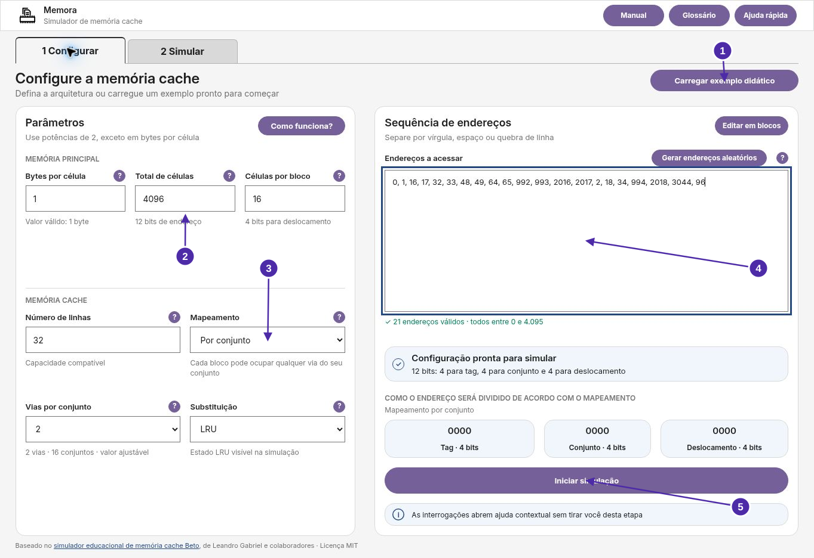
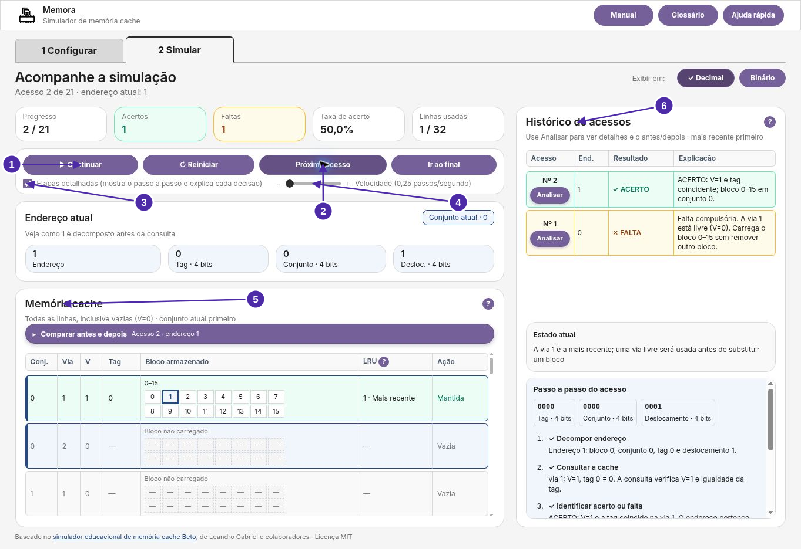
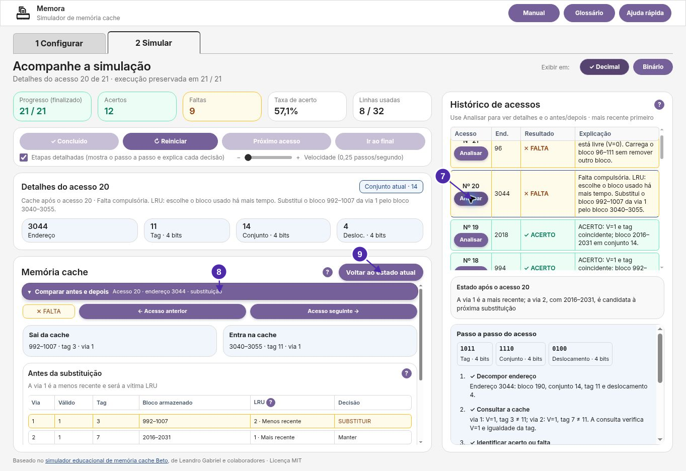
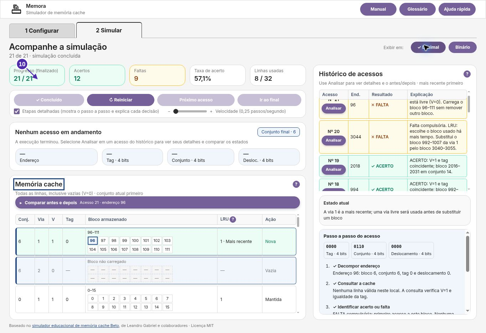

# Manual visual do Memora — Configurar e Simular

Este manual integra o painel **Manual** da aplicação. As imagens em `src/assets/manual/` são capturadas **do navegador real**, com setas e números; cada marcador possui instrução textual equivalente em `src/ui/manual-content.js`.

## Cenário reproduzível

- Fonte: `EXAMPLE_CONFIGURATION` e `EXAMPLE_ADDRESSES`, em `src/core/`.
- Para a comparação LRU: mapeamento por conjunto, 2 vias e LRU; sequência de 21 endereços. No acesso 20, sai o bloco **992–1007** e entra **3040–3055**.
- Capturas vigentes de 11/11: Chromium/CUA, 1363 × 936, interface em português, sobre o build da `main` após #99/#100. Os números foram sobrepostos a partir da geometria dos elementos lida no DOM da mesma tela, sem modificar o conteúdo da interface.
- A geração automatizada com `capture-manual.js`, em ambiente compatível, usa Chromium headless a 1600 × 900.
- Arquivos: `configurar.png`, `simular.png`, `comparacao.png`, `conclusao.png`.
- Revisão Git exata utilizada na captura, navegador e cenário: [`metadata.json`](../src/assets/manual/metadata.json), gerado juntamente com as imagens.

## Capturas atuais do manual









Para regenerar todas as imagens a partir do código atual, execute na raiz:

```bash
npm ci
npx playwright install chromium
node packages/memora/scripts/capture-manual.js
```

Não alterar manualmente os textos das capturas. A geração automatizada registra o cenário e coloca as anotações sobre os elementos reais da interface. O workflow de validação deve ser consultado antes de reutilizar imagens no apêndice.

## Verificação de 11/11/2026

As imagens mostram o botão Editar em blocos, a explicação curta de mapeamento, o ritmo de 0,25 e o retorno no cabeçalho da cache. As verificações CUA preservaram os totais de 12 acertos e 9 faltas no cenário de comparação e confirmaram os estados antes/depois do acesso 20. A [evidência técnica](../../../docs/verificacoes/2026-11-11-manual/README.md) distingue as 42 verificações manuais da suíte automatizada não executada integralmente. As imagens do artigo não foram substituídas automaticamente: seus registros históricos permanecem identificados.
