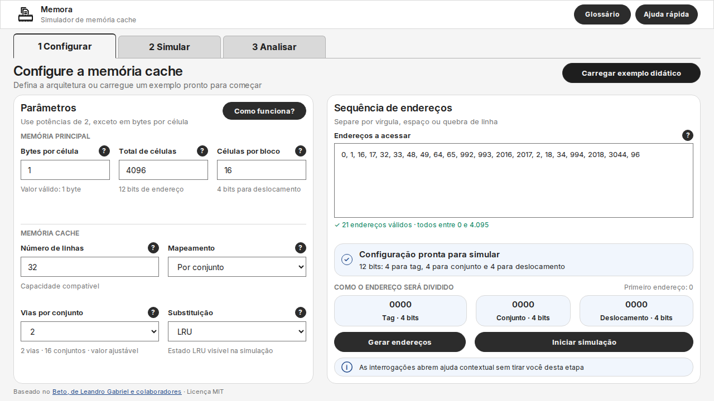
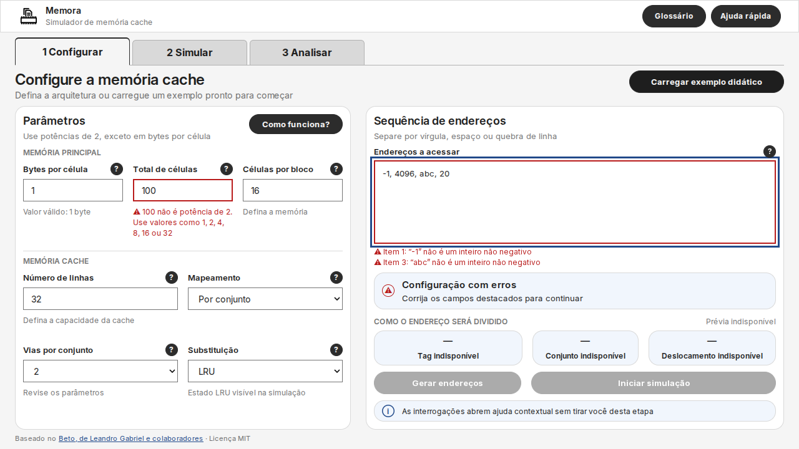
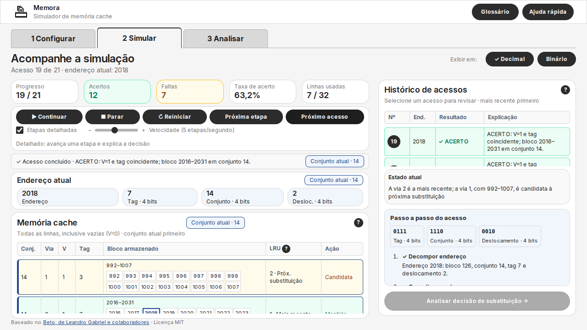
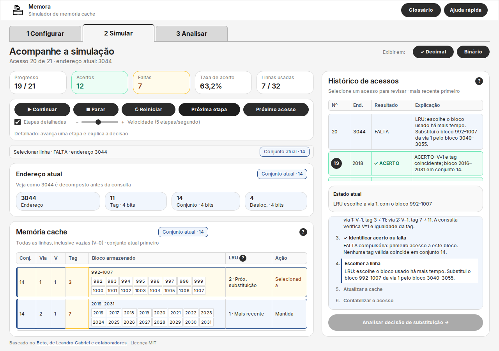
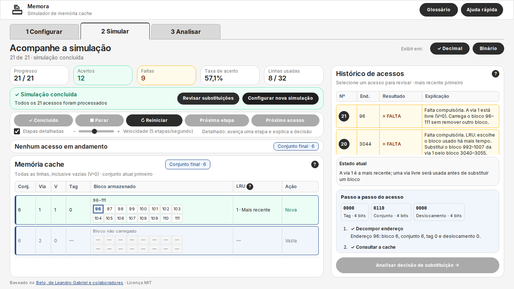
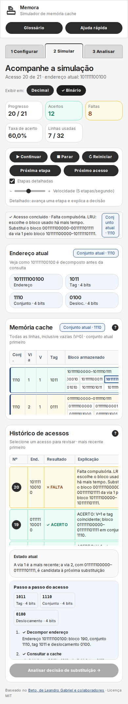

# Revisão geral do PR #44 — 14/10/2026

**Parecer:** pronto para aprovação no escopo de Configurar e Simular, após as
correções registradas abaixo. A análise da Tela 3 é a próxima entrega.
O PR continua aberto; esta revisão não o aprova nem integra à `main`.

Repositório: `LuizJr2001/memora-cache-simulator-tcc`; PR #44, branch
`feature/35-tela-2`, base `main` após o PR #43. A revisão partiu de `b963b4e`
e verificou também as correções incluídas neste registro. Ambiente local:
Node.js 24.19 e Chromium 153, com Playwright. Resultados locais, sem declaração
de CI remota, conformidade WCAG ou avaliação com estudantes.

## Fluxo verificado

### 1. Configurar e preparar a entrada

Os três mapeamentos, parâmetros condicionais, exemplo, geração e validação
automática funcionam. Erros ficam próximos aos campos. Ao tentar Simular ou
Analisar antes de preparar a entrada, o aviso vermelho orienta sobre a pendência
sem repetir a lista de campos. Com dados válidos, pede Iniciar simulação.
A preparação abre Simular zerado e não processa acessos automaticamente.

Em desktop, o campo de endereços ocupa a altura livre e mantém sua geometria
nos estados vazio, válido e inválido. Parâmetros, sequência e resumo também
mantêm suas dimensões na mesma janela; as ações e o rodapé permanecem visíveis.
Ícones, balões e textos foram inspecionados nas capturas atuais.

### 2. Executar e acompanhar as decisões

Iniciar, Pausar, Parar, Reiniciar, Próxima etapa e Próximo acesso funcionam.
A velocidade inicia em 5; o rótulo acompanha a taxa e o modo selecionado.
Etapas detalhadas muda o avanço manual e automático: uma fase no detalhado,
um acesso no resumido. Trocar de modo no meio de um acesso não o duplica.

O detalhamento mostra decomposição, consulta, resultado, seleção, atualização
e contabilização. Estatísticas só contabilizam o acesso concluído. As
explicações distinguem tags, validade, primeiro acesso ao bloco, linha livre e
FIFO/LRU/Random; preservam o bloco anterior à substituição.

A cache apresenta vias vazias com V=0 e endereços das células dos blocos
carregados, como na representação do Beto. A célula acessada é destacada.
Linhas usadas contam somente vias válidas. Paginação limita a apresentação a
128 linhas e 16 células por bloco, sem materializar configurações enormes.
Decimal/Binário preserva valores completos, inclusive de 52 bits.

### 3. Concluir, revisar e voltar à configuração

O histórico contém todos os acessos, com os mais recentes primeiro. Revisar
mostra a cache do snapshot original, mantendo os contadores da execução atual.
Voltar à execução não reprocessa dados. O filtro de substituições, reinício,
ajudas e retorno de foco foram verificados. Abrir ajuda ou sair de Simular
pausa a execução; editar a configuração invalida o estado anterior.

Analisar com entrada preparada mostra sua indisponibilidade na própria Tela 2.
Iniciar/Continuar ou avançar remove esse aviso. A Tela 3 e o botão de análise
da decisão ainda pertencem à próxima entrega.

## Problemas encontrados e corrigidos

| Problema | Correção e verificação |
|---|---|
| Setas das células perdiam o foco ao redesenhar a tabela | O foco permanece na seta acionada; no limite do bloco segue para a seta disponível. Teste com Enter nos dois sentidos, sem alterar contadores. |
| Erro em Ir à linha permanecia numa nova simulação | A preparação limpa valor, `aria-invalid` e legenda anteriores. Teste com endereço de linha inválido seguido de nova preparação. |
| Cinco expectativas de layout estavam desatualizadas | Os testes passam a medir expansão do textarea, estabilidade entre validações, espaçamentos vigentes e ausência de rolagem. Não foram removidas as verificações de geometria. |
| Documentação citava o PR #43 aberto, controles desabilitados e totais antigos | README principal, README do pacote, documentação da interface e guia de contribuição atualizados. |

## Resultados

| Verificação | Resultado |
|---|---|
| `npm run check` | 26 arquivos JavaScript com sintaxe válida |
| `npm test` | 68/68 testes Node aprovados |
| `npm run test:ui --workspace @memora/simulator` | 74/74 cenários Chromium: 45 Configurar e 29 Simular |
| `git diff --check` | Aprovado |
| Beto e licença | Arquivos executáveis do legado e LICENSE sem alteração nesta entrega |

Configurar foi medido em 801×720, 1024×768, 1180×720, 1280×720, 1366×768,
1480×742, 1536×864 e 1920×1080, incluindo erros. Simular cabe sem rolagem da
página em 1280×720, 1366×768, 1480×742 e 1920×1080, inclusive na conclusão
e revisão. Tabelas e roteiro mantêm rolagem local. Nas larguras menores
(1024, 801, 768, 390 e 320 px em Simular), a página pode rolar verticalmente,
sem overflow horizontal da página. No celular, as tabelas largas têm rolagem
horizontal própria.

### Conferência dos resultados da cache

| Cenário | Acertos | Faltas | Taxa | Linhas usadas |
|---|---:|---:|---:|---:|
| Exemplo didático: conjunto, 2 vias e LRU | 12 | 9 | 57,1% | 8/32 |
| Sequência comparada com o Beto, mapeamento direto | 13 | 8 | 61,9% | 3/32 |

No exemplo didático, o acesso 20 (3044) substitui 992–1007 por 3040–3055 na
via 1 do conjunto 14. Os snapshots preservam os dois intervalos.

A sequência do comparativo direto é
`0, 1, 6, 7, 8, 9, 992, 993, 994, 481, 482, 0, 1, 2, 996, 224, 225, 2017, 2018, 4064, 996`.
Seu estado final contém linha 0/tag 0/bloco 0–15,
linha 14/tag 0/bloco 224–239 e linha 30/tag 1/bloco 992–1007.
Os cenários usam sequências e mapeamentos diferentes; seus totais não devem
ser comparados como se fossem a mesma configuração.

## Limites e próxima etapa

Não foi encontrado bloqueio de aprovação no fluxo revisado em Chromium.
Firefox/Safari e a avaliação externa da #33 não foram executados nesta revisão.
Após aprovação e integração do PR #44, a Tela 3 continua no PR #45; sua branch
precisará incorporar os refinamentos finais de Configurar/Simular e executar
sua própria regressão antes da revisão.

Refs #35, #28, #30, #31, #37, #33.
