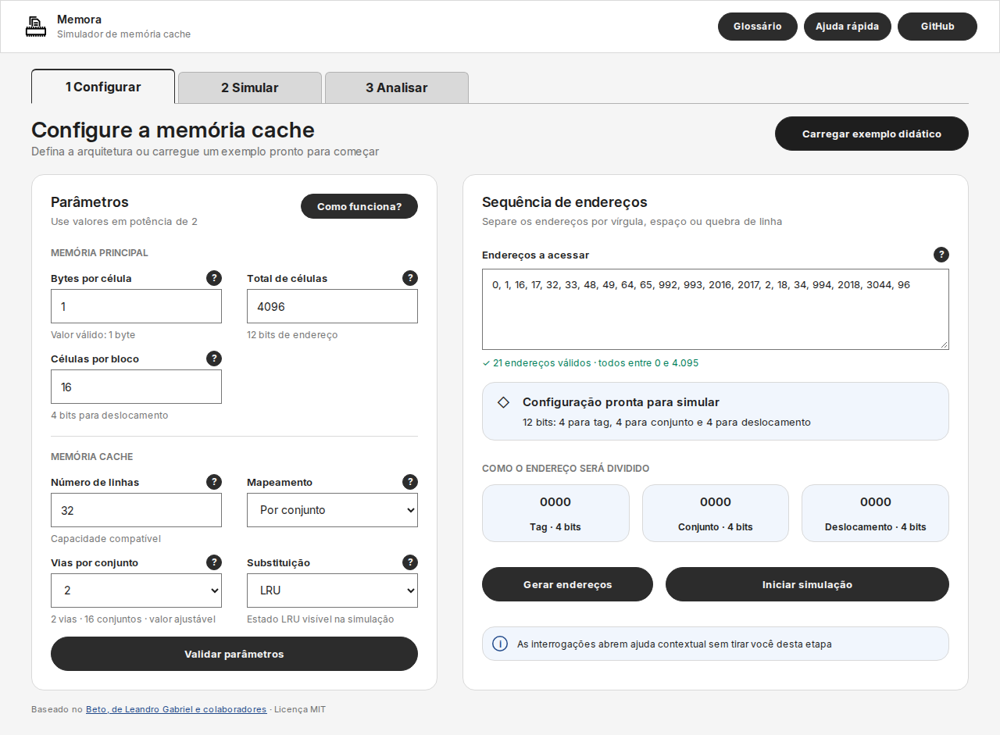

# Tela 1 — Configurar: verificação da entrega

Data: 12/10/2026 · Refs #35 e #37

A interface está restrita a `packages/memora`, com a atualização do lockfile na raiz.
O núcleo do PR #41 e os arquivos executáveis do Beto foram preservados.

## Referências e escopo

- [Tela 1](https://www.figma.com/design/Zm8dzyoG0yhkbEkC01Zvu0?node-id=311-14)
- [Página v2](https://www.figma.com/design/Zm8dzyoG0yhkbEkC01Zvu0?node-id=311-2)
- [Direto](https://www.figma.com/design/Zm8dzyoG0yhkbEkC01Zvu0?node-id=311-1354), [totalmente associativo](https://www.figma.com/design/Zm8dzyoG0yhkbEkC01Zvu0?node-id=311-1474), [por conjunto](https://www.figma.com/design/Zm8dzyoG0yhkbEkC01Zvu0?node-id=311-1594) e [casos inválidos](https://www.figma.com/design/Zm8dzyoG0yhkbEkC01Zvu0?node-id=311-1225)
- [Especificação v2](../../../docs/prototipo-v2-especificacao.md) e [decisão SDS](../../../docs/decisoes/002-simple-design-system.md)

Os campos e a sequência usam as validações existentes. A geração recebe a
memória configurada no momento da ação; vias e substituição apresentam os valores
normalizados pelo núcleo. A prévia binária decompõe o primeiro endereço válido.

As 8 ajudas de campo, Como funciona?, Glossário e Ajuda rápida usam os textos
visíveis da v2. Foram consultados os textos dos slots dos Cards, porque as
propriedades de Code Connect ainda apresentavam conteúdo anterior. A ajuda
continua estática mesmo quando a memória e os endereços são alterados.

Iniciar simulação chama `prepareSimulationInput`. O callback `onPrepared` e o
evento `memora:input-prepared` entregam a entrada imutável. A confirmação fica na
Tela 1, e editar dados invalida a entrada preparada. As etapas Simular e Analisar
aparecem sem navegação ativa. Esta entrega não executa cache ou políticas.

Adaptações para funcionamento: sequência inicialmente vazia; diálogo de geração
com quantidade; altura fluida para mensagens; resumo de erros abaixo do cabeçalho
para preservar o acesso ao exemplo didático; painéis empilhados em telas menores.

## Resultados

Ambiente: Node.js 24.19.0, Playwright 1.64.0 e Chromium 153.0.8010.0, Linux.

| Verificação | Resultado |
|---|---|
| `npm ci` | Instalação pelo lockfile concluída |
| `npm run check` | 16 arquivos JavaScript com sintaxe válida |
| `npm test` | 37 testes passaram: 28 existentes + 9 do controlador |
| `npm run test:ui --workspace @memora/simulator` | 13 cenários passaram no Chromium |
| `git diff --check` | Sem problemas de whitespace |
| Diff dos três arquivos do Beto e de `src/core` | Sem alterações |

Os cenários de navegador cobrem exemplo, três mapeamentos, alteração das vias,
troca de política, geração após editar memória, mensagens e bloqueio, preparação,
zero bits, entradas coladas acima dos limites, conteúdo seguro, operação por
teclado, as 11 ajudas, contenção/restauração de foco e fechamento por Escape,
botão e scrim. Foram verificados layouts de 1280, 768, 390 e 320 px, sem scroll
horizontal ou sobreposição entre os painéis. Inter local, peso 700 em ações/abas,
cantos retos dos campos e assets carregados também têm verificação no navegador.

Os assets locais correspondem aos slots do Figma: marca de 30 × 30 px e aros
de informação/erro de 20 × 20 px, com as dimensões renderizadas conferidas.

| Par de texto/fundo | Contraste calculado |
|---|---|
| Informação `#1E1E1E` / `#F1F6FD` | 15,35:1 |
| Botão `#F5F5F5` / `#2C2C2C` | 12,81:1 |
| Erro `#B91C1C` / branco | 6,47:1 |
| Validação positiva `#00805B` / branco | 4,95:1 |
| Texto secundário sobre a página `#707070` / `#F5F5F5` | 4,54:1 |
| Texto secundário `#757575` / branco | 4,61:1 |

O tom secundário sobre a página usa um alias local mais escuro para atingir
4,5:1. A conferência é limitada aos pares indicados e aos comportamentos testados;
não representa auditoria completa de acessibilidade ou aprovação da avaliação #33.
Safari, Firefox e as telas seguintes não foram verificados nesta entrega.

## Capturas revisadas

| Estado | Captura |
|---|---|
| Mapeamento direto | [mapeamento-direto.png](screenshots/tela-1/mapeamento-direto.png) |
| Totalmente associativo | [totalmente-associativo.png](screenshots/tela-1/totalmente-associativo.png) |
| Por conjunto, 4 vias | [por-conjunto.png](screenshots/tela-1/por-conjunto.png) |
| Erros de parâmetros e sequência | [casos-invalidos.png](screenshots/tela-1/casos-invalidos.png) |
| Side sheet, foco no botão de fechar | [side-sheet.png](screenshots/tela-1/side-sheet.png) |
| Ajuda rápida e links externos | [ajuda-rapida.png](screenshots/tela-1/ajuda-rapida.png) |
| Mobile válido, 390 px | [mobile.png](screenshots/tela-1/mobile.png) |
| Mobile com erros, 390 px | [mobile-erros.png](screenshots/tela-1/mobile-erros.png) |

Para reproduzir, siga [README](../README.md). Para regenerar as capturas,
defina `MEMORA_SCREENSHOT_DIR` ao executar os testes de navegador.
